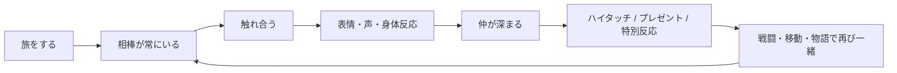
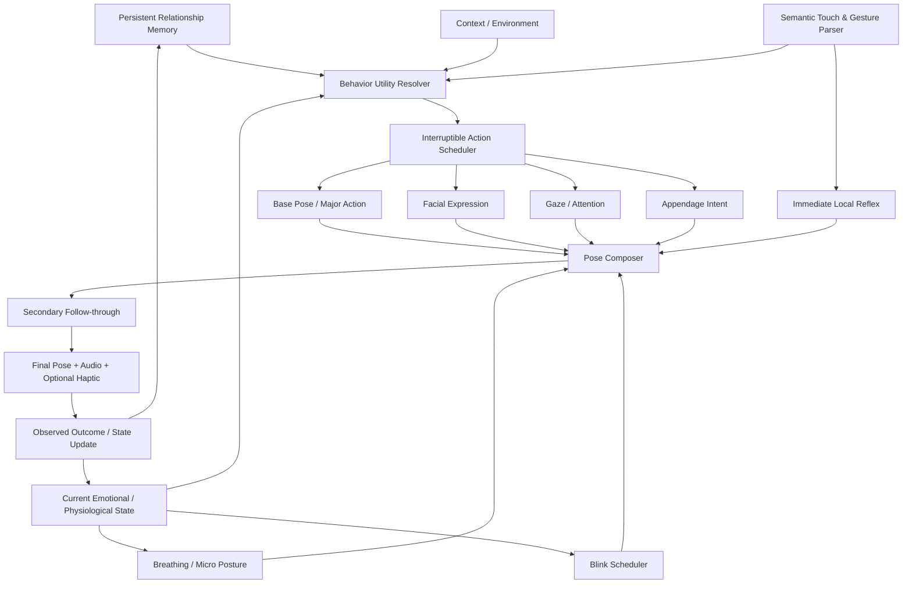
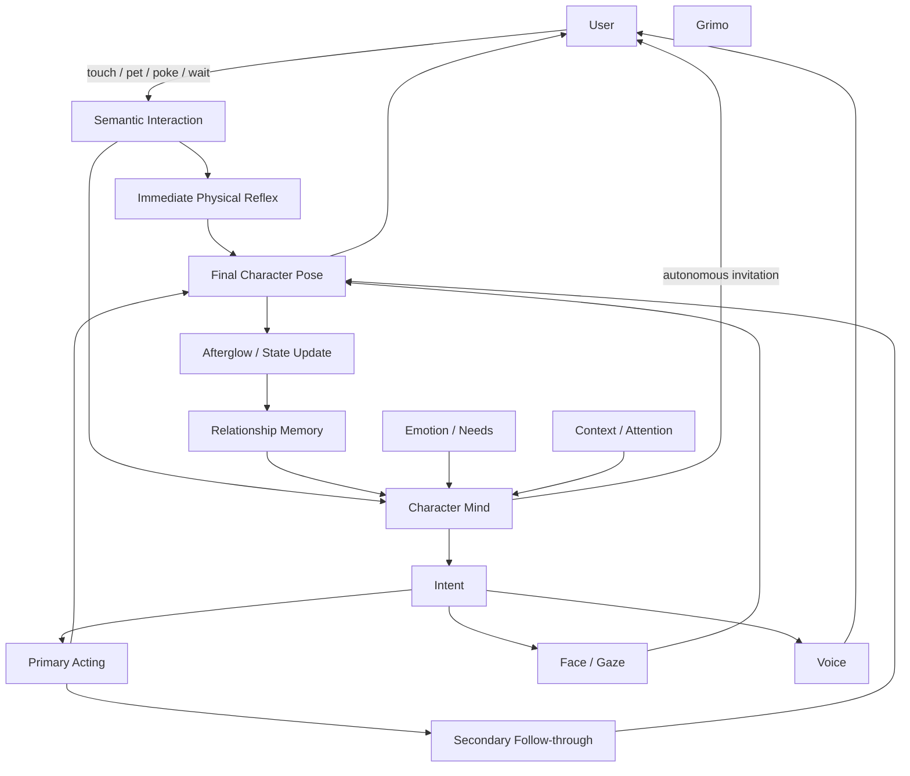

# Grimo「生きている相棒」体験設計 — Partner Pikachu / Eevee の感動を分解し、四匹へ再構成する

## 最重要結論

**結論その一。ピカブイ級の感動の正体は「高品質なアニメーション」単体ではない。**  
本質は、**相棒がプレイヤーから独立した存在として振る舞い、その存在に自分の行為が即座かつ身体的に届き、その結果が少し先の関係にも残る**という閉ループである。『Let's Go』は、撫でる・餌をあげるだけでなく、高い仲良し度でハイタッチやプレゼントが生まれ、相棒がフィールド・戦闘・移動にも継続して存在する。「触れ合い画面だけのペット」ではないことが決定的に重要だ。公式も、触れ合いを「相棒との絆」を強めるものとして設計し、タッチスクリーンでは直接触れられるようにしている。citeturn7search1turn7search10turn7search15 **【A】**

**結論その二。Partner Eevee の生命感は、汎用モーションの量ではなく「その一匹らしい偏り」によって成立している。**  
増田順一氏への『Let's Go』開発インタビューでは、ピカチュウとイーブイに**それぞれ専任のモーションデザイナー**を置いたこと、当初一人で両方を担当させる案から「愛情を分ける」ことへの懸念で二人にしたこと、結果として各相棒に大量の特徴的な仕草が入ったことが語られている。またイーブイ自体についても、ファンが何を可愛いと感じているかを調べ、幼さ、首周りや尻尾のふわふわ感などを重視したと説明されている。これは非常に強い証拠である。citeturn3view1turn24search9 **【B：一次インタビュー英訳】**  
現在のCreaturesの公式制作資料でも、アニメーターは設定だけでなく実在動物の骨格・筋肉・重力・浮力を観察し、ポケモンごとの「らしい動き」を個別に考えると説明している。citeturn12view0turn12view1turn12view2 **【A】**

**結論その三。Grimoで正式採用すべきものは「3Dキャラクター」ではなく、3Dを媒体とした relationship simulation である。**  
ゼロベースで再比較しても、四匹を最終的にピカブイ級まで持っていくなら、最終推奨は、

> **キャラクター固有の production-ready realtime 3D master  
> ＋ semantic touch  
> ＋ character-specific layered animation  
> ＋ bounded procedural micro-motion  
> ＋ persistent emotional/context memory  
> ＋ audio / optional haptic feedback  
> ＋ utility-based autonomous behavior**

である。**【E】**

3Dを採る理由は「立体だから豪華」ではない。**視線、左右非対称の耳、局所タッチ、体の一部だけの反応、割り込み、接触位置への追従、secondary motion、感情の余韻を、同じキャラクター個体の連続した状態として合成しやすいから**である。逆にこれらを実装しないなら、full 3Dにする価値は大幅に減る。**【D/E】**

最終的な目標を一文にすると、

これがGrimoの北極星である。**【D/E】**

**総合一位：Web-native realtime full 3D + relationship runtime**  
**品質上限一位：同方式をhero-quality authoringで最大化**  
**production効率一位：3D master + modular motion primitives + procedural micro-layer**  
**Web/PWA適性一位：lean web-native realtime 3D**  
となる。2D/2.5Dは canonical fidelity の保険としては残すが、現時点の第一案には戻さない。**【E】**

調査上の重要な制約も先に明示する。『Let's Go』内部の具体的なbone数、blendshape数、animation graph、state machine、spring solver、QA基準、社内DCC、facial-rig構造は公開資料からは確認できない。したがって本レポートでは、それらを「Game Freakが実際にこう作った」とは断定しない。公開開発者発言は **A/B**、映像から見えるものは **C**、そこからの逆算は **D**、Grimo仕様は **E** と厳密に分離する。

## ピカブイが感動を生む理由

### 開発者側から見た「可愛さ」の作り方

『Let's Go』は、単に旧作を高解像度化する企画ではなく、増田氏が「誰でも遊べるPokémon」として、家族やリビング空間を意識し、ビジュアルを過度に写実的・怖くせず、音楽にもクラシック楽器を使って心地よい方向を目指したと説明している。フィールド上のポケモンについても、種ごとに歩き方・止まり方・周囲を見る動作などを変え、「見ているだけでも生き生きしている」ことを意識していた。citeturn4view0turn24search9 **【B】**

ここから重要なのは、**生命感を「大きく動くこと」と取り違えていない**点である。歩く、止まる、見るという低エネルギーの動作にも種固有性を与えている。これは後述するCreaturesの現行制作思想とも一致する。Creaturesの公式アニメーターインタビューでは、体重によって動作速度が変わる、骨・筋肉・重力を意識する、動物園・水族館・書籍・動画を観察する、といった手順が明示されている。citeturn12view0 **【A】**

Partner Eeveeはさらに別格である。増田氏はファンがイーブイの何を愛しているかまで調査し、幼い印象、首元と尻尾の柔らかさなどを押し出した。しかもピカチュウとイーブイに専任モーションデザイナーを一人ずつ置いた。これは「可愛いモデルを作った後で共通アニメーションを載せる」のとは正反対の制作思想である。citeturn3view1turn24search4 **【B】**

Grimoへの第一の翻訳はしたがって、

> **model bible と同格の motion-personality bible を四匹それぞれに持つ。**

である。**【E】**

Jill、Pino、Shushuに `happy_01`, `idle_02`, `pet_good` を単純共有してはいけない。共有してよいのは、

- event schema
- timing framework
- gaze solver
- touch classifier
- scheduler
- emotion model
- animation mask system

までであり、**最終的なポーズ、振幅、テンポ、どの部位を先に動かすか、settleの仕方はキャラクター固有**にするべきである。**【E】**

### 「声」は飾りではなく身体の一部

イーブイの声についても制作密度は高い。開発インタビューでは多数の候補から声を選び、触れ合いモードのために多くの音声を収録し、アニメ側の音響監督とも連携したことが述べられている。増田氏自身も『Let's Go』の音響全般を監修し、家庭で大きめの音量で流しても威圧的にならない方向を意識していた。citeturn3view1turn24search4 **【B】**

ここから得られるGrimo要件は、**音声を完成後に乗せるSEレイヤーとして扱わない**ことである。**【E】**

```text
指が頬へ入る
→ 皮膚/毛の局所反射
→ 瞳・まぶた
→ 頭部が指側へ少し寄る
→ 小さな声
→ 耳
→ 胴体
→ fleece follow-through
→ 呼気のような小音
→ 満足した表情の残留
```

が一つのイベントである。音だけ0.3秒遅れたり、毎回同じ声が頭から鳴ったりすると「キャラクターが鳴いた」ではなく「SEが再生された」に変わる。**【D/E】**

最終版では一匹あたり、巨大な台詞ライブラリよりも、まず**短い非言語vocal paletteを大量に揃える方が優先度が高い**。目安として、neutral acknowledgement / curious / pleasure / deeper pleasure / surprise / protest / irritation / sleepy / invitation / effort / recovery などを含め、**40〜80程度の短いvocal/foley unitをvariation込みで持つ**ことを推奨する。これは公開Pokémon仕様ではなくGrimo向けの制作目安である。**【E】**

### 直接触ることが「自分と相棒」の因果を作る

公式は、携帯モードではタッチスクリーンを使い相棒に**直接**触れることを明示している。撫でる、餌を与える、髪型を変える、高い仲良し度でハイタッチやプレゼントを受け取るという行動が同じ相棒に連続して結び付く。citeturn7search1turn7search3 **【A】**

これはHCIの古典的なdirect manipulationと非常に相性がよい。Shneidermanが整理したdirect manipulationの核には、対象を継続的に表示し、操作を速く・段階的に行い、その結果をすぐ見せることが含まれる。citeturn27search2 **【A：HCI研究】**

したがって、Grimoのタッチは、

> `tap on character → happy animation`

では不十分である。**【E】**

必要なのは、

> `触った場所 × 指の軌跡 × 速度 × 持続時間 × 往復性 × 現在行動 × 現在感情 × 直前履歴`

に対して、キャラクターが身体的に整合した結果を返すことである。**【E】**

| 入力 | 最初の反応 | 続く反応 | 意味 |
|---|---|---|---|
| 軽いtap | 頬・まぶたが一瞬反応 | 指を見る | 「何？」 |
| slow pet | 触点へわずかに寄る | 目を細める・耳が緩む | 快 |
| 往復stroke | 徐々に力が抜ける | 顔・姿勢まで快状態 | 深い快 |
| 短時間の連打 | local recoil | 視線→耳→不満 | 境界 |
| さらに連打 | 先読みして避ける | protest/離脱 | 「嫌だ」 |

と変えるべきである。**【E】**

重要なのは最後の二行である。**何をしても喜ぶキャラクターは、短期的には可愛くても長期的には「おもちゃ」に見える。** Pokémon-Amie/Refreshでも、種ごとに好きな場所・嫌う場所があり、危険な部位では電気・熱・冷気など、そのポケモン自身の身体的性質に対応する反応まで用意されていた。これは「主体には境界がある」という感覚を強くする。**【C/D】**

### 感動は「従順さ」ではなく agency から生まれる

Partner Eeveeは、プレイヤー入力を待つだけではない。公式説明でも、相棒は気分や様子に応じて異なる仕草で迎え、プレゼントを持ってきたり、ハイタッチを始めたりする。citeturn7search1turn7search10 **【A】**

進化させようとすると拒否反応を見せる映像も、主体性が感情を生む好例である。**【C】**

これは、

```text
Player → Character
```

だけだった関係を、

```text
Player ⇄ Character
```

へ変える。

さらに理想は、

```text
Character → Player
```

から始まるイベントが一定割合存在することだ。**【D/E】**

ユーザーにとって「自分がボタンを押したから演出された」より、「この子が今、自分から何かしてきた」の方が、相手の心を推論しやすい。Epley・Waytz・Cacioppoの擬人化理論は、人が非人間対象へ心や意図を帰属する条件を、agent knowledge、effectance、sociality motivationなどから説明している。citeturn27search20 **【A：心理学一次研究】**

Grimoではこれをゲーム的に利用する。ただし人間化するのではなく、

- 自分から目を見る
- 見ないこともある
- 一瞬考えてから近づく
- 前回の行動を覚えているように振る舞う
- 気になるものへ注意を逸らす
- 同じ刺激でも毎回完全には同じ反応をしない
- 嫌なら嫌と言う
- 何もせず一緒にいる時間もある

という**non-human agency**を作る。**【E】**

### 「絆」が別画面まで持ち越される

Pokémon-Amie、Refresh、Partner Playの強い点は、触れ合いがそこで閉じないことである。触れ合い・世話によるaffection/friendshipは、その後の戦闘挙動や特別な反応に接続される。『Let's Go』でも仲良くなるほどハイタッチやプレゼントなどが現れると公式に説明されている。citeturn7search1turn7search15 **【A】**

Ryan、Rigby、PrzybylskiのSelf-Determination Theoryをゲームへ適用した研究では、autonomy、competence、relatednessの充足が楽しさや継続意図と関係することが示されている。citeturn27search4 **【A：心理学一次研究】**

Grimoで特に重要なのは**relatedness**である。ポイントが上がったから報酬が出るのではなく、

> 「今まで一緒にいたから、この子がこうなった」

と知覚できる必要がある。**【D/E】**

したがって、Grimoのlong-term memoryはRPGの巨大なステータス表ではなくてもよいが、最低限、

```text
bond/familiarity
preferred interaction history
recently touched zones
repetition pressure
current mood
arousal
fatigue
last interaction time
last major event
rare-event cooldown
recent autonomous actions
```

を保存し、**目に見える行動差**へ変換する必要がある。**【E】**

### 希少行動は「報酬」ではなく発見になる

ハイタッチやプレゼントのように、常に同じ手順で即座に取り出せない行動はユーザー間で「こんなことをした」という物語になりやすい。Partner Playについて、ユーザーが珍しいハイタッチの発生条件を探したり報告したりしていること自体が、その発見性を示す質的証拠になる。citeturn20search12 **【B：ユーザー証言、一般化には注意】**

ただしGrimoで「完全ランダム」にしてはいけない。

最適なのは、

> **原因は理解できる。しかし具体的な表現は完全には予測できない。**

状態である。**【E】**

例えば「ゆっくり頬を撫でれば基本的には喜ぶ」は安定させる。一方で、

- 目を閉じる
- 少し頭を寄せる
- 小さく声を出す
- 耳だけ反応する
- 一瞬こちらを見る
- 撫で終わった後にさらに寄ってくる

の組み合わせは変える。

**touch causality は deterministic寄り、performance は stochastic寄り**にする。これが「分かりやすい操作」と「生き物らしい予測不能性」を両立する。**【E】**

### 多感覚の一致

Poké Ball Plusは光・振動・音を組み合わせ、公式自身がポケモンとの冒険を現実側へ持ち出す装置として説明していた。citeturn7search13 **【A】  
公式が掲載したユーザーコメントにも、振動や鳴き声によって「ポケモンの世界にいる」「トレーナーになった」感覚を持ったという声がある。これは統制実験ではないが、定性的には興味深い。citeturn7search4 **【B：公式収集ユーザー証言】**

Grimoではスマートフォンそのものが接触装置なので、

```text
visual local reflex
+ character vocal
+ contact foley
+ optional device vibration
```

を同期させる。**【E】**

ただしhapticはplatform capabilityに応じたprogressive enhancementとし、**生命感の成立条件にはしない**。**【E】**

### 感動の統合モデル

以上から、本調査ではPartner Eevee級の感動を次の近似モデルで捉える。これは公開Pokémon公式ではなく、証拠を統合したモデルである。**【D】**

\[
EmotionalImpact \approx
Identity \times Contingency \times Agency \times TemporalRichness
\times Persistence \times MultisensoryCoherence \times Discovery
\]

そこから、

\[
Repetition + Latency + GenericMotion + UncannyMismatch
\]

をペナルティとして引く。

**乗算**と考えるのが重要である。**【D】**

したがってGrimoの品質投資順位は、

> **identity → causality → agency → timing → variation → rendering polish**

とする。**【E】**

これは「ポリゴン数を増やす」より先である。

## 映像から見える生命感の構造

### 映像コーパス

以下は本調査で参照した**二十本以上の映像コーパス**である。長尺実況の一部は自動transcriptにフレーム単位の時刻情報が付かないため、そこは `≈` を付けた概算区間、または「全編」を示している。したがってこれはanimation timingをフレーム精度で計測した表ではなく、**行動variationの観察コーパス**である。フレーム精密なタイミング値はGrimoのbenchmark capture段階で実機再収録すべきである。**【C】**

| 映像 | URL / timestamp | 観察ポイント | 分類 |
|---|---|---|---|
| SwitchForce – Let's Go Eevee Part 1 | `https://www.youtube.com/watch?v=FoJ_sG66_Sw` / ≈相棒獲得部 | 初対面から指に興味を示す、飛び出す、体全体で近づく。実況者が実際に笑顔になり「cute」と反応 | C |
| Let's Go Pikachu/Eevee Walkthrough Part 1 | `https://www.youtube.com/watch?v=h8VngcF6_r8` / 序盤 | 相棒導入、体を前に出す、視線と頭の同期 | C |
| iSneakSometimes – First Pokémon | `https://www.youtube.com/watch?v=Hn8j0d_yNjc` / 序盤 | Poké Ball Plus音声、相棒の初対面反応、声と身体動作の同期 | C |
| Mustard Plays – Let's Go Part 1 | `https://www.youtube.com/watch?v=v4FtnsPXrus` / 序盤 | 通常移動と相棒の継続存在、フィールドとの接続 | C |
| Kiara Playz – Let's Go Eevee | `https://www.youtube.com/watch?v=fEw37N5i_t8` / ≈00:00–00:25 | 実況者自身が鳴き声に即時「so cute」と反応。声が第一印象を強化 | C |
| Partner hidden interaction / high-five | `https://www.youtube.com/watch?v=urO8T5i9y_8` / 全編 | ハイタッチ系の相互作用、ユーザーが待つ→相棒から応じる構図 | C |
| Petting Eevee | `https://www.youtube.com/watch?v=STAeo2ofmmM` / 全編 | 継続strokeに対する表情・頭部・身体反応 | C |
| “Eevee Petting Simulator?” | `https://www.youtube.com/watch?v=ZCaZ0EJ7Hss` / 全編 | direct-touchの反復と反応variation | C |
| Evolution refusal – Pikachu/Eevee | `https://www.youtube.com/watch?v=hKIv8gANUf0` / 00:00–00:58 | プレイヤー意図に従わない主体的拒否。表情→身体の大きなreaction | C |
| Evolution refusal 別capture | `https://www.youtube.com/watch?v=fgeT92UCkXg` / 全編 | 同じテーマの別capture。キャラクターの意思表示 | C |
| Pre-release gameplay compilation | `https://www.youtube.com/watch?v=VAeDswz4Mnw` / 全編 | close-up interaction、相棒中心のフレーミング | C |
| Pokémon Let's Go official JP trailer | `https://www.youtube.com/watch?v=JWhNT8cGTiM` / 全編 | 公式が相棒との共同生活・接触を商品体験の中心として提示 | C/A |
| Nintendo overview video | `https://www.youtube.com/watch?v=7Wtfkl-g-VE` / 全編 | 触れ合い、移動、戦闘を一つの「相棒」体験として接続 | C/A |
| Let's Go walkthrough | `https://www.youtube.com/watch?v=1YN9w6jGaoU` / 序盤 | 相棒の継続的presence、overworldとinteractionの連続性 | C |
| Partner interaction capture | `https://www.youtube.com/watch?v=KiwrSNGOujM` / 全編 | Partner Play時のclose-up、入力への身体反応 | C |
| TyranitarTube Let's Go Part 8 | `https://www.youtube.com/watch?v=pEKsBn381U8` / 全編 | 通常ゲームプレイ中の相棒presenceと、専用画面だけに閉じない存在感 | C |
| Pokémon-Amie high-five | `https://www.youtube.com/watch?v=tjOIQskFqk4` / 全編 | 入力せず待つ行為が「手を出してくる」社会的gestureに変わる | C |
| Pokémon-Amie retrospective footage | `https://www.youtube.com/watch?v=O0bXBsl-NYM` / Amie区間 | 好き/嫌い部位、高-five、危険部位、face interaction等のvariation | C/B |
| Pokémon-Amie short comparison | `https://www.youtube.com/shorts/iLoxVfuAiao` / 全編 | direct pettingと後世代interactionの差を比較 | C/B |
| All Gen-7 Pokémon Refresh | `https://www.youtube.com/watch?v=fFa99PCD1O0` / 例: Rowlet 00:48、Litten 02:32、Rockruff 17:10、Mimikyu 41:15 | 種ごとに体型・顔・摂食・反応速度が大きく異なる。同一システムでも演技はspecies-specific | C |
| Sword/Shield – All Curry Reactions | `https://www.youtube.com/watch?v=Lwhtrzh8FpA` / 00:00–04:19 | 共通event「食事」に対して複数の感情強度・個体表現を見せる | C |
| Oddish in Pokémon Camp | `https://www.youtube.com/watch?v=TvZhML3TMQE` / 全編 | 小さなポケモン固有の移動テンポと自律行動 | C |
| Following Pokémon Best Moments | `https://www.youtube.com/watch?v=3JTS5voyDJ0` / 00:00–03:15 | 移動速度や追従性そのものが種のキャラクター性になる | C |
| Scarlet/Violet Switch 2 gameplay | `https://www.youtube.com/watch?v=BAXyXQtPWo0` / 03:24以降 | 複数ポケモンが自律的に歩く/泳ぐ/見ることで「世界が自分なしでも続く」感覚が強まる | C |
| Scarlet gameplay stream | `https://www.youtube.com/watch?v=NJT4EjmXARw` / 全編 | 後世代のoverworld creature presenceの比較材料 | C |
| Pokopia companion/world behavior | `https://www.youtube.com/watch?v=zrdo-UUFBuo` / 全編 | 性格・生活要求・環境への反応がattachmentを作る最新比較例 | C |

このコーパスに加えて、Pokémon-Amie / Refresh / Camp / Picnicの公式・準公式仕様を比較した。Scarlet/Violet公式ではPicnic中にポケモンが各自で過ごし、話す・遊ぶ・洗うことができる設計になっている。Campでも複数体が同時に自由行動し、プレイヤー以外のポケモン同士の関係を観察できる。これはPartner Playとは違う種類の生命感であり、Grimoでは両方を統合すべきである。**【A/B/D】**

### 映像に繰り返し現れるmicro-pattern

映像群を「どのanimation clipがあるか」ではなく、**時間構造**で見ると、かなり安定したパターンが出る。**【C/D】**

#### 入力を認識してから感情になる

優れた反応は、

```text
刺激
↓
認識
↓
局所反射
↓
attention shift
↓
facial evaluation
↓
primary body reaction
↓
secondary follow-through
↓
settle
↓
afterglow
```

という段階を持つ。**【C/D】**

例えば「撫でた瞬間にhappy全身animationが再生」ではなく、まず耳や頬、まぶたなど触れた近傍が変わり、その後に頭・表情・姿勢へ意味が伝播する。この**因果が身体の中を伝わる感じ**が生命感になる。**【D】**

#### eyes/head/bodyが同時スタートしない

注意対象が変わるとき、全関節が同じframeから同時に同方向へ動くとロボットっぽく見える。映像では視線、頭、耳、体軸などの時間差が感じられる。**【C】**

Grimoでは厳密な固定値にせず、キャラクター固有の範囲を持たせる。例えば初期目安として、

```text
eyes / facial acknowledgement     0–100 ms
head orientation                 60–220 ms
body commitment                 150–450 ms
appendage follow-through        200–700 ms
settle                         500–1800 ms
afterglow                      1–5 s
```

程度から演出を調整する。**【E：制作初期値でありPokémon実測値ではない】**

#### afterglowがある

最大の差の一つである。

悪い実装：

```text
pet
→ happy animation
→ neutral
```

良い実装：

```text
pet
→ surprise
→ pleasure
→ settle
→ still slightly pleased
→ later neutral
```

**反応が終わったあとも「さっき撫でられた」という状態が残る。**【C/D】

これはGrimoで必須とする。**【E】**

#### 完全静止と常時運動の中間にいる

Creaturesの公式アニメーション方針が示すように、重さや生物学的説得力は重要であり、生命感は「全部の部位を絶えず動かすこと」と同義ではない。citeturn12view0 **【A】**

むしろ、

- breathはほぼ常時だが微小
- gazeは断続的
- blinkは不規則
- earsは注意刺激に応じる
- tailは感情状態により休止する
- posture shiftはさらに低頻度
- 大きな自発行動は希少

と頻度帯を分離するべきである。**【D/E】**

**意図的静止は生命感の一部**である。すべてが常に揺れていると「idle shader」に見えてしまう。

#### 左右対称を崩す

目、耳、足、tailなどが完全同期しないことが重要である。**【C/D】**

ただし単なるrandom offsetでは駄目で、

- 左側に刺激が来た
- 右側に注意対象がある
- 体重が左足に乗っている
- 一方の耳だけ警戒している

など、**理由のあるasymmetry**を優先する。**【E】**

#### repetitionに対して同じ反応を返さない

Amie系では連続で触ると満足度や反応が変化し、嫌う部位も存在する。Partner Eeveeでも気分によるreaction variationが公式に強調されている。citeturn7search1 **【A/C】**

Grimoでは同じ入力を十回した場合、

```text
1回目  認識
2回目  受容
3回目  より深く喜ぶ
4回目  小さなvariation
5回目  慣れる
6回目  少し飽きる
...
```

のように変える。もちろんキャラクターごとに曲線を変える。**【E】**

### Partner Eeveeで特に強い構造

Partner EeveeがAmie一般より強く感じられる理由は、**同じ個体がゲーム全体を横断する**ことにある。**【D】**



公式もPartner Pokémonを単なる初期ポケモンではなく、肩・頭などで旅を共にし、触れ合いや着せ替えが可能な存在として一貫して扱っている。citeturn7search1turn7search15 **【A】**

この循環こそGrimoが模倣すべき対象である。

**「触れ合い機能」だけ真似るのは間違いである。**

## Grimoの生命感モデルと具体仕様

### 五種類のanimation causality

Grimoの動作を「idle / happy / sad」のようなclip名だけで分類せず、**なぜ動くか**で五群に分ける。**【E】**

| causality | 例 | 実装 |
|---|---|---|
| 常時生理 | breath、微小姿勢維持 | low-amplitude continuous |
| stochastic / asynchronous | blink、耳、視線逸らし | bounded stochastic scheduler |
| internal-state-driven | 疲れ、安心、警戒、興奮 | emotional parameter layer |
| environment/attention-driven | 指を見る、UIを見る、外を見る | gaze/attention controller |
| event/input-driven | poke、pet、gift、large reaction | semantic event + authored reaction |

ポイントは、これらを**独立randomで動かさない**ことである。

各channelは非同期だが、

```text
valence
arousal
trust
attention
fatigue
curiosity
repetitionPressure
```

という共有stateの影響を受ける。**【E】**

これにより「全部がバラバラに勝手に動く」ではなく、

> 同じ気分を共有しながら、それぞれの身体部位が違うタイミングで反応する

状態になる。

### 推奨runtime



最重要なのは、**touch reflexだけは高レベルbehavior plannerを待たずに返す**ことだ。**【E】**

人が頬を触ってから、

```text
gesture classify
→ emotion state update
→ utility AI
→ clip selection
→ animation transition
```

を全部待って100〜300ms後に初動すると、触覚的因果が弱くなる。

先に、

```text
touch
→ local reflex immediately
```

を出し、その後で意味的なreactionを重ねる。**【E】**

### latency requirement

一般のWeb UXではCore Web VitalsのINPは**200ms以下が“good”**とされ、研究背景として100ms前後が即時性の重要な境界として扱われている。citeturn26search0turn26search16 **【A：Web公式】**

しかしキャラクターへの直接接触は通常UIより厳しくするべきである。したがってGrimoでは次を**独自品質目標**とする。

| 指標 | Grimo目標 | 根拠区分 |
|---|---:|---|
| pointer → first visible local acknowledgement | median ≤ 50 ms | E |
| 同 p95 | ≤ 80 ms | E |
| semantic reaction onset p95 | ≤ 100 ms | E |
| continuous pet tracking | render frameごと | E |
| PWA全体 INP p75 | ≤ 200 ms | A/E |
| animation hitch | 50 ms超frameを極小化 | A/E |

Webでは50msを超えるmain-thread taskがlong taskとして扱われるため、continuous interaction中の重い分類・physicsをmain threadに集中させない方針とも整合する。citeturn26search25 **【A】**

### semantic touch

full skinned-mesh colliderを毎frame精密計算するより、Grimoには**semantic hit volumes**を推奨する。**【E】**

例：

hit volumeをbone/controlへ追従させ、

```text
screen pointer
→ camera ray
→ semantic volume
→ local coordinates
```

を取得する。

gestureは、

```text
tap/poke
slow pet
continuous stroke
back-and-forth rub
hold
rapid repeated poke
```

程度から始める。

最終reaction selectorは、

```text
zone
× gesture
× emotion
× bond
× repetition
× currentBehavior
× recentHistory
× personality
```

で決める。**【E】**

候補reaction `r` の選択は概念的には、

\[
Score(r)=
Compatibility
+Personality
+AffectFit
+ContextFit
+Novelty
-RepetitionPenalty
-InterruptionCost
\]

でよい。最高点を常に選ぶのではなく、上位候補から重み付き抽選することでvariationを作る。**【E】**

### facial / gaze requirement

「自由な人間顔rig」は必要ない。むしろ canonical identity を壊す危険がある。**【E】**

四匹には最低限、

- eye aim
- left/right eyelid independent control
- blink intensity
- eye openness
- mouth/jaw
- mouth cornerまたはmuzzle form
- cheek/compression
- head pitch/yaw/roll
- ear/appendage affect
- species-specific expression controls

を持たせる。

初期制作予算としては一匹あたり**十二〜二十四程度のidentity-safe facial channels**を推奨する。これはPokémon内部仕様ではなくGrimoのstarting budgetである。**【E】**

重要なのは数ではなく、

を定義すること。

例えば、

```text
eyeScale      0.97–1.02
eyeYaw        safe range
mouthOpen     safe range
cheekRaise    safe range
headRoll      safe range
```

をQAで制約する。

可愛さを出そうとして目を20%巨大化したり、口角を人間のように大きく変えたりすることは避ける。**【E】**

### motion libraryの必要量

ピカブイの開発者自身が「多くの特徴的な仕草・動き」を入れ、見続けても飽きにくいことを狙ったと述べている。citeturn3view1 **【B】**

Grimoでも「idle一個 + pet一個」では到達しない。

最終hero character一匹について、制作計画の開始値として、

| motion family | 推奨motion primitive数 |
|---|---:|
| base living / idle | 8–15 |
| posture / weight shift | 6–10 |
| gaze/head attention | 8–15 + procedural |
| blink/face micro | 6–12 |
| ears/tail/appendage additive | 12–25 |
| touch positive | 15–25 |
| touch neutral/curious | 8–15 |
| touch negative/boundary | 8–15 |
| autonomous interactions | 12–20 |
| large delight/surprise | 8–12 |
| transition/settle/recovery | 12–20 |

を目安にする。**【E】**

ただしこれは約百本の「長い完成clip」を作れという意味ではない。**短いmotion primitivesを再利用し、mask/additive/procedural layerで組み合わせる**。

例えば、

```text
pleased_cheek_pet_A
+
ear_relax_variant_C
+
blink_soft_B
+
gaze_return_delayed
+
fleece_followthrough
```

なら一つの新規フルbody clipを作らず別reactionとして成立する。**【E】**

### 全身は常に動かさない

最終仕様では各channelへ**activity budget**を与える。

| channel | baseline activity |
|---|---|
| breath | nearly continuous / very small |
| eyelid | intermittent |
| gaze | intermittent |
| head | sparse |
| ears | attention-driven |
| tail | state-dependent |
| limbs | mostly still except weight shift |
| fleece/flowers/leaves | only from body/environmental cause |
| large action | rare |

**secondary structuresが原因なしにずっと揺れるのは禁止**とする。**【E】**

fleece全体が常時波打つと「毛」ではなくゼリーになる。

### 四匹への物理的適用

公開されているCreaturesの制作思想ではphysical correctnessそのものより、骨格・筋肉・重さの説得力を使って「そのポケモンらしい」動きを作ることが重視される。citeturn12view0turn12view1 **【A】**

Grimoも**appeal > simulation purity**とする。**【E】**

| Grimo | primary motion | secondary | 禁止したい失敗 |
|---|---|---|---|
| Jill | wing/leaf/tailの意図はauthored | 先端だけspring/procedural | wingを布physics任せ |
| Pino | body/tail intentはauthored | tail end、bubble/water motif | 水表現が本体演技を支配 |
| Shushu | body/flower/bouquetの意図はauthored | 花弁・小装飾の遅れ | bouquetがcloth simulation任せ |

原則は、

> **意味を持つ動きは animator が決める。  
> 意味のない微細な遅れだけphysicsに任せる。**

である。**【E】**

## 実装候補の比較と最終推奨

### 十八軸で再評価

以下は**Grimo要件に対する推定評価**であり、Pokémonの実装方式を示す表ではない。各十点、**すべてE評価**である。

候補は技術を先に固定せず、emotion architectureとして比較した。

| 評価軸 | Web-native realtime 3D | Unity WebGL 3D | 3D+2D hybrid | segmented 2.5D | 3D→pre-render 2D |
|---|---:|---:|---:|---:|---:|
| canonical fidelity | 9 | 9 | **10** | **10** | 9 |
| animation-quality ceiling | **10** | **10** | 9 | 7 | 8 |
| sense of life | **10** | **10** | 9 | 7 | 6 |
| facial quality | 9 | **10** | 9 | 9 | 8 |
| gaze | **10** | **10** | 9 | 8 | 5 |
| touch causality | **10** | **10** | 9 | 7 | 5 |
| autonomous behavior | **10** | **10** | 9 | 7 | 6 |
| secondary motion | 9 | **10** | 9 | 7 | 8 |
| interruptibility | **10** | **10** | 8 | 8 | 4 |
| motion scalability | 9 | 9 | 8 | 7 | 4 |
| three-character scalability | 9 | 9 | 8 | 7 | 6 |
| authoring efficiency | 7 | 8 | 6 | **8** | 5 |
| AI automation | **9** | 8 | 8 | 8 | 7 |
| PWA compatibility | 9 | 6 | 8 | **10** | **10** |
| Pixel 7a performance | 8 | 6 | 8 | **10** | **10** |
| asset footprint | 7 | 5 | 6 | 9 | 5 |
| maintainability | **9** | 7 | 6 | 8 | 5 |
| long-term extensibility | **10** | 9 | 8 | 6 | 4 |
| **合計** | **164/180** | 157/180 | 147/180 | 143/180 | 115/180 |
| **換算** | **91%** | 87% | 82% | 79% | 64% |

### 最終推奨

**総合一位は Web-native realtime full 3D。**

具体的には、

> **高品質3D master + character-specific rig + authored motion primitives + layered animation composer + semantic touch + utility behavior + persistent state**

を採用する。**【E】**

DCCについては最終品質とAI自動化の両方から**Blenderを第一候補**、runtimeはPWAとの親和性から**PlayCanvas Engine standaloneを第一候補**とする。ただし emotional architecture はPlayCanvas固有APIに埋め込まず、後からThree.js/Babylon等へ移植可能なTypeScript domain layerとして分離する。**【E】**

これは以前の採用案を守ったのではない。本調査で**「なぜ感動するか」側から逆算しても同じ結論に戻った**という位置付けである。

### 品質上限案

同じrealtime 3D architectureだが、

- hand-authored reaction増量
- facial variation増量
- character-specific audio増量
- higher-order secondary controls
- rare autonomous behavior増量
- professional animatorによる最終polish

へ予算を寄せる。**【E】**

**品質上限を上げる最大要因はrenderer変更ではなくcharacter actingの密度**である。Creatures自身が「動き」をポケモンを生きて見せる役割として扱い、個別観察と長期的なmotion refinementを続けていることとも整合する。citeturn12view0turn12view2 **【A/D】**

### production効率最大案

production-ready 3D masterは削らない。

削るのはclip数で、

```text
fewer high-quality primary motions
+
procedural gaze
+
procedural blink
+
parameterized head/ear/tail additives
+
reaction modular composition
```

とする。**【E】**

**低品質なfull-body animationを大量生成するより、高品質な十五個のprimitiveを組み合わせる方を選ぶ。**

### Web/PWA最大案

同じ3D architectureを保ち、

- lower geometry
- texture compression
- limited active morphs
- fewer material passes
- no runtime cloth/soft-body
- selective spring chains
- audio lazy loading
- animation bundle streaming

へ振る。**【E】**

2.5Dへ即戻るのではなく、まず**表現システムを維持したまま3D asset costを落とす**。

### Pixel 7a class のstarting budget

以下は公式ハード制限ではなく、vertical slice用の**保守的な初期budget**である。**【E】**

| 項目 | 初期目安 |
|---|---:|
| visible triangles / hero | 30k–80k |
| deformation bones | 45–80 |
| secondary/control bones | 必要箇所のみ |
| identity-safe facial channels | 12–24 |
| simultaneously active morph contributions | おおむね3–8 |
| character draw calls | 可能なら8以下 |
| primary textures | 1K–2K中心 |
| compressed cached character asset | 8–20 MB目安 |
| first-interaction essential payload | 3–8 MBを目標 |
| runtime cloth/soft-body | 原則なし |
| secondary chains | 数本〜十数本、選択的 |
| animation target | 60fps |
| degradation floor | stable 30fps以上 |

Pixel 7aでこの値なら必ず動くという意味ではない。**Gate Eで実機測定し、実測結果が予算を決める。**

### authoring cost

これも公開Pokémon工数ではなく、**Grimo品質向けのperson-hour-equivalent概算**である。AIが実作業を担当しても、品質比較のため人間制作時間相当に換算している。**【E】**

|---|---:|
| canonical reconstruction / final model | 100–220 h |
| rig / skin / facial / deformation | 60–140 h |
| living-state motion library | 100–220 h |
| touch + reaction library | 100–220 h |
| behavior/audio/runtime integration | 50–120 h |
| QA / iteration / canonical regression | 50–120 h |
| **hero-quality合計** | **460–1,040 h equivalent** |

四匹目まで同じ工数にはならない。runtime、tools、gesture classifier、export、QAを共有できるため、二匹目以降はかなり下げられる。一方、**character actingとcanonical QAは共有してはいけない**ため、完全な量産品にはならない。**【E】**

先ほど正式採用したAstra → Sol/Terra分業とも整合する。

Astraを使うべきなのは、

```text
canonical interpretation
model master
rig architecture
facial architecture
identity envelope
hero motion grammar
first interaction quality bar
```

であり、その後、

```text
clip variants
Blender Python
export
runtime binding
automated screenshots
performance regression
parameter sweeps
```

はSol/Terra側へ下ろせる。**【E】**

## 感情設計パターンと四匹へのproduction requirement

### 「animation state machine」ではなく二階層にする

FSMだけで、

```text
IDLE
PETTING
HAPPY
ANGRY
```

とすると、すぐ機械になる。

代わりに、

```text
Behavior / Intent
```

と、

```text
Continuous Emotional State
```

を分離する。**【E】**

```text
behavior = sitting_idle
```

のままでも、

```text
valence      +0.4
arousal      -0.2
trust        +0.8
attention    player
```

に変えられる。

その結果、

- eyesが柔らかい
- blinkが少し長い
- 耳が緩い
- head offsetが近い
- breatheがゆっくり
- 次の自主interaction確率が高い

という**同じidleの中の違い**が生じる。**【E】**

### emotionを離散ラベルだけにしない

内部stateは少なくとも、

```text
valence
arousal
trust/bond
curiosity
comfort
fatigue
irritation
social-seeking
```

程度のcontinuous値を推奨する。**【E】**

UIに表示する必要はない。むしろ数値を見せない方が「生き物」の印象を保ちやすい。

### repetition suppression

各reactionに、

```text
lastUsedAt
recentUseCount
cooldown
similarityGroup
noveltyWeight
```

を持たせる。

同じgestureのreaction候補が、

```text
A 40%
B 30%
C 20%
D 10%
```

ならAが出た直後は、

```text
A 5%
B 40%
C 35%
D 20%
```

程度へ変える。**【E】**

ただしランダム性を増やし過ぎず、**感情として不自然なreactionは候補から外す**。

### interruptibility

ユーザーが大きなidle action中に頬を触った場合、

悪い挙動は、

> motion終了まで反応しない

または、

> 一瞬で全部cancelしてneutralからpet animationへ飛ぶ

である。

推奨は、

```text
current action
→ local reflex immediately
→ determine interrupt class
→ soft-abort / hard-abort / defer
→ transition pose
→ touch reaction
```

である。**【E】**

各actionへ、

```text
interrupt.none
interrupt.soft
interrupt.hard
```

を定義する。

例えば、

- blink → hard interrupt不要
- self-groom → soft
- large jump → dangerous phase中はdefer
- sleep → touchで徐々にwake

となる。

### anticipationを必須にする

大きいreactionは、いきなり最大poseへ行ってはいけない。

```text
notice
→ prepare
→ action
→ overshoot
→ settle
```

を基本形にする。**【E】**

例えば相棒からのinvitationなら、

```text
こちらを見る
↓
少し身を乗り出す
↓
一瞬待つ
↓
手/前脚を出す
↓
ユーザー入力を待つ
↓
成功
↓
喜ぶ
↓
名残
```

にする。

**「待つ」というanimationしていない時間が、相互作用を成立させる。**

### autonomous action scheduler

相棒が自発行動をする条件は単純なrandom timerではなく、

```text
timeSinceInput
currentMood
bond
recentAction
rareCooldown
userAttentionEstimate
characterContext
```

で決める。**【E】**

例：

```text
3秒入力なし
→ gaze away

8秒入力なし
→ posture shift candidate

15秒入力なし
→ self-groom / inspect environment candidate

30秒入力なし
→ invitation candidate

rare
→ gift-like / special interaction
```

ただし時間は固定せず分布を持つ。

### 「何もしない」をschedulerに入れる

候補actionに、

```text
intentional_stillness
```

を明示的に入れる。**【E】**

これにより、schedulerが毎秒何かしなければならない状態を防ぐ。

### motion-personality bible

四匹それぞれに最低限、以下を正式資料化する。

| 項目 | 内容 |
|---|---|
| resting silhouette | 最も「その子」に見える静止 |
| center of mass | どこへ重さを感じさせるか |
| motion tempo | 急/遅 |
| motion amplitude | 小/大 |
| anticipation strength | 控えめ/大きい |
| settle speed | すぐ戻る/余韻型 |
| gaze style | 長く見る/ちら見 |
| asymmetry | どこに出るか |
| preferred touch | body semantics |
| disliked/sensitive touch | boundary |
| surprise style | 局所/全身 |
| vocal behavior | 頻度/強さ |
| autonomous behaviors | 個性 |
| forbidden poses | canonicalを壊すpose |

**これをmodel specと同格のsource of truthにする。**【E】

### 四匹で共有しないもの

他個体のrigをJillへ無理にretargetしない。
Jillのwing grammarをShushuへ転用しない。  
Pinoのtail dynamicsを他個体へ無条件に転用しない。

共有するのはruntime contractである。

```ts
interface CharacterBehaviorContract {
  semanticZones: ZoneDefinition[];
  gestureMappings: ReactionRule[];
  animationChannels: ChannelDefinition[];
  emotionalParameters: EmotionalState;
  autonomousBehaviors: BehaviorDefinition[];
  audioPalette: AudioDefinition[];
}
```

**physical rigは固有、behavior APIは共通。**【E】

これは四匹展開性を最大化する。

## 優先実行項目と最終設計判断

### 最優先で実装するもの

Grimoで価値が高い順に並べるとこうなる。**【E】**

| 優先 | requirement | 理由 |
|---:|---|---|
| 最優先 | canonical-faithful production master | identityが崩れれば全て失敗 |
| 最優先 | semantic touch + immediate local reflex | 「自分が触った」因果 |
| 最優先 | gaze / eyelid / head coordination | 相手に見られている感覚 |
| 高 | afterglow | 記憶のある存在に見える |
| 高 | asynchronous life channels | 非入力時の存在 |
| 高 | motion-personality bible | generic character化防止 |
| 高 | repetition suppression | canned感防止 |
| 高 | autonomous invitation | agency |
| 高 | character-specific audio | 感情の身体化 |
| 中高 | persistent relationship memory | 長期愛着 |
| 中 | secondary physics | 身体の説得力 |
| 中 | rare interaction | discovery / sharing |
| 後 | visual VFX増量 | 生命感の根本ではない |

### Grimoが「やってはいけない」実装

最も危険なのは以下である。**【E】**

**一枚絵全体のbounce/squash**  
既に禁止されているが、本調査でも完全に不適切。

**一つの“breathing”で体全体を周期伸縮**  
周期が読めた瞬間に機械になる。

**blinkを固定intervalにする**

**耳と尻尾をrandom noiseで常時揺らす**

**touchした瞬間にfull-body happy clipへ飛ぶ**

**同じところを何度撫でても同じreaction**

**全interaction後に即neutral**

**何を触っても喜ぶ**

**AI生成motionをreviewなしで大量投入**

**四匹に同一motionをretargetして個性とする**

**rare eventを低確率RNGだけで出す**

**physicsに可愛さを決めさせる**

**高poly化を生命感の改善と誤認する**

### production organization

ピカチュウとイーブイにそれぞれモーション担当を置いたという開発者証言は、Grimoで非常に重い示唆を持つ。citeturn3view1 **【B】**

小規模AI制作だから四人の専任animatorを雇う必要はない。

しかし**論理的には四人のmotion directorが存在するように制作管理する**べきである。**【E】**

つまり、

```text
Jill motion identity
Pino motion identity
Shushu motion identity
```

を別spec、別review checklist、別reference libraryとして扱う。

Codexが作業する際も、

> 「Grimo共通 happy animationを作れ」

ではなく、

というtaskにする。

これなら下位モデルへ作業を落としてもidentityを守りやすい。**【E】**

### AIに任せる場所、人間判断を残す場所

| 領域 | AI / procedural | human-quality judgment |
|---|---|---|
| rig script generation | ◎ | architecture review |
| export/validation | ◎ | — |
| touch collider placement initial | ◎ | final feel |
| motion variant generation | ○ | timing/appeal |
| gaze/blink scheduler | ◎ | personality tuning |
| secondary solver | ◎ | appeal limits |
| screenshot/video regression | ◎ | final interpretation |
| canonical similarity metrics | ◎ | 「可愛いか」 |
| animation cleanup | ○ | hero poses |
| facial expression generation | △ | **必須** |
| large emotional reaction | △ | **必須** |
| character personality | × | **必須** |

**最高品質を決める最後の一割は自動化しない。**【E】

### Repository rebuildへの影響

現在repoの具体実装を前提にせず分類だけすると、

**残すもの**

```text
product shell
PWA infrastructure
navigation
account/data layer
non-character business logic
general UI assets
```

**archiveするもの**

```text
過去のcharacter prototype
旧2D/2.5D experiment
過去のmotion experiments
比較用benchmark
```

削除ではなくbenchmark/referenceとして残す。

**廃止候補**

```text
whole-image idle transform
character-specific hacks tightly coupled to UI
generic reaction animation assumptions
```

**新しく作るもの**

```text
character-domain/
  relationship-memory
  emotional-state
  attention
  behavior-utility
  animation-scheduler
  semantic-touch
  reaction-resolver
  audio-behavior

character-runtime/
  pose-composition
  gaze
  blink
  facial
  additive-motion
  secondary-motion
  performance-budget

characters/
    identity-spec
    rig-spec
    motion-bible
    touch-map
    behavior-library
  jill/
  pino/
  shushu/
```

**【E】**

### 最終アーキテクチャ

最終的に目指すべきものはこうなる。



ここで最も重要な矢印は、

```text
Character → User
```

である。

ユーザーが何もしなければ何も起きないキャラクターは、どれだけ高精細でも「生きている相棒」には届かない。**【D/E】**

### 最終推奨

今回の調査から、正式な目標仕様を次の一文に固定することを推奨する。

> **Grimoの四匹は、入力に応答する3Dキャラクターではなく、身体・気分・注意・好み・記憶を持つように知覚され、ユーザーとの相互作用を時間的に積み重ねる四つの小さな“人格的存在”として制作する。** **【E】**

そしてproduction architectureは、

> **Blender-class production-ready 3D master  
> → character-specific rig / face / secondary controls  
> → glTF/GLB  
> → web-native realtime 3D  
> → semantic touch  
> → layered pose composition  
> → utility behavior + persistent relationship memory**

を最終推奨一位とする。**【E】**

ただし、ピカブイから最も強く学ぶべきことは3D技術ではない。

増田氏らはイーブイを「ファンが何を愛しているか」まで遡って設計し、ピカチュウとイーブイの動きに別々の人間を割り当て、大量の固有仕草と声を与えた。citeturn3view1turn24search4 **【B】**  
Creaturesも現在、モデルを作る前に設定や内面まで読み込み、実在生物を観察し、骨格・筋肉・重さを考え、社内チェックと監修を通じて「そのポケモンらしさ」を磨くと公式に説明している。citeturn12view0turn12view1turn12view2 **【A】**

つまりGrimoが本当に再現すべき制作原理は、

> **技術をキャラクターへ適用するのではなく、  
> キャラクターを理解し尽くした結果として技術を選ぶこと。**

である。**【D/E】**

一瞬だけ触れた場所が反応し、  
少し遅れてこちらを見て、  
目元が柔らかくなり、  
耳が片方だけ緩み、  
頭をほんの少し預け、  
巨大なfleeceが遅れて収まり、  
小さく声を漏らし、  
指を離したあとも数秒だけ満足そうにしている。

そして次に開いたとき、  
前とまったく同じではない。

**その積み重ねが、Grimo版の「相棒イーブイ」である。** **【C/D/E】**

## 証拠強度と残る不確実性

本レポートで最も強く確定できる事実は、公式が相棒との直接触れ合い・絆・ハイタッチ・プレゼントを明示していること、増田氏がEeveeの可愛さを研究し、Partner Pikachu/Eeveeそれぞれに専任motion designerを置いたと語っていること、そしてCreaturesが現在も生物観察・個別性・骨格/筋肉/重さ・継続的motion refinementを重視していることである。citeturn7search1turn3view1turn12view0turn12view2 **【A/B】**

一方、公開資料から確認できないため断定しない事項は、

- Let's Go Partner Eeveeの正確なbone count
- facial rig方式
- blendshape数
- joint facialかmorph主体か
- animation graph内部構造
- additive animationの具体実装
- gazeがproceduralかauthoredか
- secondary motionがphysicsか手付けか
- touch collision方式
- reaction selection algorithm
- internal state machine
- QAの定量基準

である。

最新Pokémon制作については、CEDEC 2026の公式プログラム上、Pokémon LEGENDS Z-Aでrig system「ポケリグ」の進化・運用事例を扱う技術セッションが存在することまでは一次資料で確認できる。citeturn15search1 **【A】**  
しかし、その最新pipelineをそのまま2018年の『Let's Go』へ遡及適用することはできないし、Grimoの最適解とも自動的にはならない。**【D】**

その意味で、研究の最終地点は文献ではない。

そこがGrimoの最終的なGo/No-Go判定である。
