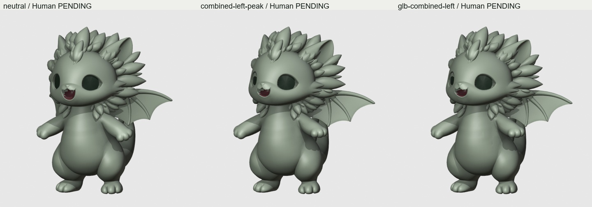

# Jill Rig Other v001 — 実装・検証・残課題

2026-10-15 / **IMPLEMENTED REVIEW CANDIDATE / 総合HOLD / Human外観承認PENDING**。

調査だけ・計画だけでは終了せず、編集可能なblendとGLBを制作した。限定した保存/再操作/出力再現は成立したが、自然な瞼と根の接合品質に未達があり、依頼された「完成Rig」としての承認は主張しない。

## Authority / 手順 / 原本保護

- main `8e4996c63c6d8fbb41954a2aa5cb5d892e45f01b`をfetchしてAGENTS/Goal√map/Handoffを確認。納品直前fetchでも同SHA。
- Jill NOWは`7f16127322685216bbd8bb93065cb3de4203568c`の[HANDOFF](https://github.com/snowtone-ai/Grimo/blob/7f16127322685216bbd8bb93065cb3de4203568c/docs/production/jill/HANDOFF.md)、[v002 REVIEW](https://github.com/snowtone-ai/Grimo/blob/7f16127322685216bbd8bb93065cb3de4203568c/docs/production/jill/evidence/smartmesh25k-v002/REVIEW.md)。Canonical/承認Body-only4方向の比較板とMotion候補contact sheetを直接開いて照合。Motion候補はHuman PENDINGで、承認poseに昇格していない。
- Exa Search / Firecrawlと公式Blender資料で公開制作実務、比較解剖/力学、skinning/corrective/facial/glTFを調査。[Plan](Plan.md)にURL・読了範囲・採用理由・公開事実/推論/創作設計を記録。鳥/蝙蝠の翼は前肢であり、Jillの独立した追加翼対は創作設計。
- Planを`832e1e89bcbfadb74f14154a87211056b997497c`で**先にcommit**。その後に原本copyとRig編集。サブエージェントなし、追加課金/Tripo操作なし。
- 専用worktree/枝で隔離。元checkoutは初期`0947d03`から並行作業で`d5e9882`へ進んだがreset/checkout/mergeしていない。Shushu dirty、他キャラ、root追加ファイルを変更していない。v002 master/Canonical/承認Body-onlyも上書きしていない。[manifest](manifest.json)に実ファイルhashと保護対象の照合を保存。

## Intake / 実装したもの

[source/README](../../../../assets/grimo/production/jill/tripo/rig-other-v001/source/README.md)に原本名・SHA256。[FBX対応](source-correspondence.json)、[raw GLB照合](source-glb-comparison.json)。

- 第一候補FBXは28,050v / 54,361tri / 78 joints、v002とindexed polygon対応一致。uniform normalization後の最大座標差`1.631e-7`。元GLBの46,003 seam split頂点もサーフェス最大差`2.706e-7`で一致。元GLBのimport時bind配置は採用せず、FBX/v002 restから再構成した。
- v002 bodyの**Basis座標差0**、FBX UV loop差0。元bodyの面/色材質を保持。追加物は左右瞼の独立mesh（350v×2）、Neutralでは幅`.00035`のrim strip。正式Textureは作成していない。画像の淡緑/暗眼/口内色は一時的な検査表示で、保存blend/GLBに焼き込まない。
- 130骨（129 deform、root1）、うち94葉骨。六肢の所有を分離し、forelimb scapulaとwing girdleを別系統にした。巻尾は曲線arcに沿う6区間、葉は頭/首胸/尾のownerへ所属。人型finger/twist群をpaw等へ統合した。
- 39意味channel：胸/呼吸、頭首、左右wing open/fold・flap/camber、低paw、tail sway/curl、地域葉、左右gaze/blink/smile/cheek、mouth、胸touch、四肢IK。各葉は追加`local_bend`。gazeは小角の眼面回転候補で、正式Textureなしでは眼差しの最終品質を判定しない。
- body18morph＋左右瞼各1＝20。翼根open/fold左右、肩左右、尾root左右の8 correctiveは、局所DQ目標−LBS差分を実際のLBS行列で逆変換して格納。Neutralで0、小さいmask内に限定。膜camber/口/頬/胸touch/尾curlは別shape。
- 左右paw/footのworld IK target、非stretch、足のworld orientation lock。接触/支持/装備/holding等16anchor。接触/足裏nodeは元body/翼/下向き足裏面に投影して配置し、衣装/口/補助保持のstand-off targetと区別した。
- [control contract](control-contract.json)、[正確なdriver式/rest行列/IK mapping](runtime-mapping.json)、[操作手順](../../../../assets/grimo/production/jill/tripo/rig-other-v001/README.md)。任意runtimeのIK/pose readerは別実装が必要。

## 実検証と数値の意味

Blender 5.2.1 LTSを別background processで起動して保存blendを再読込。18ケースのNeutral→半分→極値→半分→復帰を作り、Front/Side/3Q、逆Side、根元/顔の拡大を実renderした。画像を直接開いて評価した。これは限定したcontrol proofで、完成演技集ではない。

| Check | 結果 / 限界 |
|---|---|
| weights | 最大4influences、未weight頂点0、正規化誤差`2.22e-16`（authoring数値）。GLBはfloatへ変換 |
| 18ケース×5評価点 | NaNなし、新規degenerate triangle 0、各ケース復帰差0。全域edge比`.467–1.872`で、最大は口閉じ周辺。比率だけで自然さPASSにしない |
| 修正履歴 | 初回の頭のhard weight境界で複合時12.24倍の局所伸長→首/肩への連続falloffへ修正し、同複合極値1.50倍以下。body Basisは変更なし |
| 再読込後の直接ch操作 | proof actionを外して18極値を再操作し保存評価と差0。全resetは浮動小数点差`1.333e-7` |
| 独立性 | 翼の片側操作で他領域、paw操作で翼/眼/低足、尾操作で顔/翼の固定点差は最大`1.333e-7`。全身の任意条件を保証するものではない |
| GLB fresh import | 27同時刻サンプルでbidirectionalサーフェス差≤`1e-5`。観測body最大`9.785e-6`、p99最大`3.687e-7`、瞼最大`2.813e-7`、anchor最大`3.820e-7`。seam split/未使用頂点を区別して比較 |
| GLBの時刻 | 30fpsを**import前**に設定。実accessorは`1/30–361/30秒`なのでauthoring frameと同じframeで照合。初期24fps import/誤った開始offsetは棄却した |
| GLB内容 | 3mesh、130 skin joints、20 morph、16anchor、1 sampled proof（361frames、393ch、translation/rotation/scale/weights）。drivers/IKのロジックをGLBへ格納したという意味ではない |
| IK/接触 | [測定](contact-control-validation.json)。小さなtarget移動で反対肢のeffector差0、scale差0。届かないtargetの誤差を伸長で隠さない。小offset probeでpaw最大`.002293`、足最大`.000255`の残差。Neutral接触nodeの最近傍surface距離は最大`.000121`。任意poseでの厳密なprop contactはHOLD |

[build](build-report.json) / [poses](pose-validation.json) / [roundtrip](roundtrip-validation.json) / [frames](proof-schedule.json)。最後の変更は非renderの接触node位置のみ。body/瞼/weights/morph/proof poseを変えていないため、画像の再大量生成は行わず、最終exportの同時刻geometry/nodeを再比較した。

## 直接開いて判断した画像 / HOLD

- [翼 Front/Side/3Q](01-wings.jpg)：片/両翼のopen/foldが独立し、顔や前肢が引かれない。foldは小角の後方回転で、完全に背へ畳む機構は未成立。翼根は首葉と重なり、膜が胴/葉へ入る箇所の見通しが不足する。**接合/貫通の最終品質HOLD**。
- [paw・尾・頭首・支持](02-body.jpg)：低pawで肩の急な裂けを修正。太尾の丸い断面と巻き形を大きく維持。支持の低下は小さく、真のrump-supported sittingではない。肩/尾根/葉の局所面は承認poseによる再判定が必要。
- [顔・複合・中間](03-face-composite.jpg)：閉眼時の眼球露出を局所瞼で覆ったが、丸い塞ぎ面と眼窩の境界が目立つ。自然で幼い閉眼線・half-lidとしては**FAIL/HOLD**。口は動くが完全閉鎖/歯や内面の重なりも未仕上げ。単なるmorphの動作を表情品質PASSとしない。
- [復帰](04-return.jpg)：顔/胴/翼/尾がNeutralへ戻る。体型/顔のNeutral編集で破綻を隠していない。
- [根元/顔の拡大](05-details.jpg)：葉の付根、翼の膜/フレームと胴の重なり、尾葉の段差を確認。v002由来の不連続/薄い部位を含み、skinning/correctiveだけで仕上げたとは言えない。未解決の隙間/重なりを隠していない。
- [GLB再import画像](06-glb-roundtrip.jpg)：Neutral/閉眼/複合をFront/Side/3Qで再描画し、body/morphの再現を確認。Human可愛さ承認ではない。

Canonical/承認Body-onlyとの本人性の判定は、元v002自体のGeometry HOLDを引き継ぐ。座標を保存したことはCanonicalとの外観一致を証明しない。承認済みの閉眼/翼fold等のpose referenceも未取得。続行には、眼窩と瞼の局所接合・口内・根の重なりを修正した画像へのHuman判断が必要。体型/顔をRig都合で再設計して解決しない。

## Q01–Q15 coverage

| Q | 本納品での状態 |
|---|---|
| Q01 顔 / Q02 headneck | 独立制御と出力を実装。Q01外観HOLD、Q02小角候補、極値のHuman承認なし |
| Q03 支持 / Q04 forelimb | 足IK・orientation lock・低paw・小支持変化を実証。真の座位/片肢支持/厳密接触/全reachは未達 |
| Q05 / Q07 / Q08 | 他個体固有、対象外・他キャラ編集なし |
| Q06 Jill翼/胸/葉/尾 | 独立系統とcorrectiveを実装。根の接合、完全fold、複合の最終見えはHOLD |
| Q09 Food | 小口とmouth targetまで。5style/残量/在庫/実prop接点は未実装 |
| Q10 Wear | 所有anchor/exportまで。装脱/1Wear状態/実物fitは未実装 |
| Q11 session / Q12 Secret | 商品state/演技を実装していない |
| Q13 Gift/保持 | 左右holding/assist nodeまで。移管event/保持競合/prop演技は未実装 |
| Q14 重層/割込 | bounded複合とNeutral復帰を実証。任意現在姿勢/実prop/状態を通した割込保証はない |
| Q15 export/fullspatial/mobile | blend/GLB再現・複数方向の実renderまで。スマホ/PlayCanvas/360全pose/performanceはUNKNOWN |

正式Texture、全Motion、飛行、翼/尾の荷重支持、筋simulation、連続collision solverは納品範囲外。HOLDを根拠なくPASSへ昇格しない。

## 再現

入力は[manifest](manifest.json)と照合する。Blender 5.2.1 LTSのbackgroundで次のscriptを順に実行する（repo root基準、`--python`）。Plan gateは上記commitで既に成立している。

1. `scripts/blender/audit-jill-rig-source-v001.py` — source read-only対応検査。
2. `scripts/blender/build-jill-rig-other-v001.py` — 新規派生Rigを構築・保存。
3. `scripts/blender/prove-jill-rig-other-v001.py` — 保存blend再読込、proof保存、GLB export、実render。nodeのみの変更なら`-- --no-render`可。
4. `scripts/blender/verify-jill-rig-roundtrip-v001.py` — 再読込直接ch/GLB fresh importと同時刻照合。成功時`bounded_pass:true`。`-- --no-render`も可。
5. `scripts/blender/inspect-jill-contact-controls-v001.py`、`capture-jill-rig-detail-v001.py` — 接触測定/必要な拡大画像。
6. bundled Pythonで`board-jill-rig-evidence-v001.py`、`finalize-jill-rig-evidence-v001.py` — boards/hash manifest。

受入は「限定技術再現」「Codex画像所見」「Human承認」を別々に扱う。現在の総合判定は**HOLD**。
